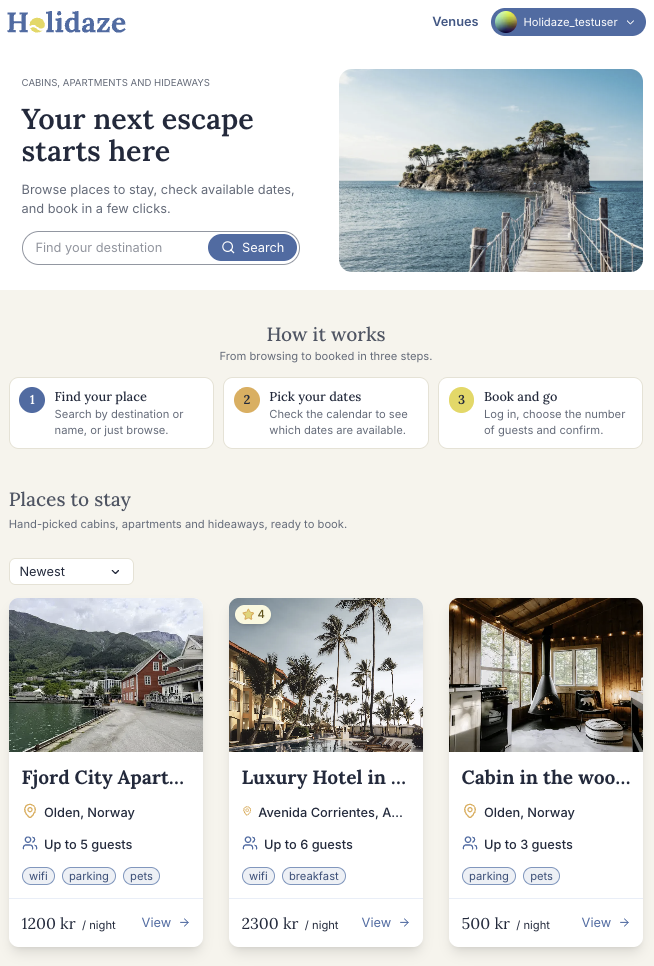

# Holidaze - Project exam 2

A venue booking platform where users can browse and book holiday venues, and venue managers can list and manage their own properties. Built with Next.js and the Noroff Holidaze API as my Project Exam 2 at Noroff.



## Links

- **Live site:** https://holidaze-fawn.vercel.app/
- **Figma prototype (desktop):** [View prototype](https://www.figma.com/proto/1AO7MDi3zMciNmRqcwzuUq/Exam-Project-2?node-id=48-2036&p=f&viewport=95%2C527%2C0.07&t=zlYZKxa2ueFrtr2L-1&scaling=min-zoom&content-scaling=fixed&starting-point-node-id=48%3A2036&page-id=48%3A2035)
- **Figma prototype (mobile):** [View prototype](https://www.figma.com/proto/1AO7MDi3zMciNmRqcwzuUq/Exam-Project-2?node-id=62-2895&t=PCpVXCATjCFnSUyD-1)
- **Kanban board:** [View projectboard](https://github.com/users/AlexanderLislelid/projects/7/views/1)
- **Style guide:** [View styleguide](https://www.figma.com/design/1AO7MDi3zMciNmRqcwzuUq/Exam-Project-2?node-id=1-1262&t=AohLyBZkqKEV77Z1-1)
- **Gantt chart:** [View roadmap](https://github.com/users/AlexanderLislelid/projects/7/views/4)

## Overview

Holidaze is a fictional company that handles bookings for venues. The site was made for two types of users: guests who simply want to browse and book a venue, and venue managers who create their own venues and track incoming bookings.

## Features

### Visitors

- [x] Browse a list of venues, with "Load more" pagination
- [x] Search for venues by name or description
- [x] Sort venues by newest, price (low/high) or rating
- [x] View a single venue page with image carousel, amenities, location map and a calendar showing booked and available dates
- [x] Register as a customer or venue manager (requires a `stud.noroff.no` email)
- [x] Log in and log out

### Customers

- [x] Create a booking by picking dates and number of guests, with total price calculated before confirming
- [x] View upcoming bookings on the profile page, and all bookings (past and upcoming) on a separate page
- [x] Cancel an upcoming booking
- [x] Update avatar, banner and bio
- [x] Upgrade the account to venue manager

### Venue managers

- [x] Create a venue with images, amenities, location and price
- [x] Edit and delete own venues
- [x] View all venues they manage
- [x] View bookings for each managed venue, with a calendar of booked dates and a list of guests
- [x] Prevented from booking their own venues

## Tech Stack

- [Next.js 16](https://nextjs.org/) (App Router)
- [React 19](https://react.dev/)
- [Tailwind CSS 4](https://tailwindcss.com/)
- [Zustand](https://zustand.docs.pmnd.rs/) – state management
- [React Hook Form](https://react-hook-form.com/) + [Zod](https://zod.dev/) – forms and validation
- [React DayPicker](https://daypicker.dev/) + [date-fns](https://date-fns.org/) – calendars and dates
- [Embla Carousel](https://www.embla-carousel.com/) – image carousel
- [Lucide](https://lucide.dev/) – icons
- [Noroff Holidaze API](https://docs.noroff.dev/docs/v2/holidaze/bookings) – backend
- ESLint + Prettier
- Hosted on [Vercel](https://vercel.com/)

## Getting Started

### Prerequisites

- Node.js v20.9 or later
- npm

### Installation

1. Clone the repository:

   ```bash
   git clone <!-- repo-url -->
   cd holidaze
   ```

2. Install dependencies:

   ```bash
   npm install
   ```

3. Create a `.env.local` file based on `.env.example`:

   ```bash
   cp .env.example .env.local
   ```

   ```env
   NEXT_PUBLIC_API_KEY=your-api-key-here
   ```

   To get a Noroff API key, the easiest way is to use the API key tool in the [Noroff API documentation](https://docs.noroff.dev/docs/v2/auth/api-key).

4. Start the development server:

   ```bash
   npm run dev
   ```

   Open [http://localhost:3000](http://localhost:3000) in your browser.

## Available Scripts

| Script                 | Description                      |
| ---------------------- | -------------------------------- |
| `npm run dev`          | Start the development server     |
| `npm run build`        | Build the app for production     |
| `npm run start`        | Run the production build         |
| `npm run lint`         | Run ESLint                       |
| `npm run format`       | Format code with Prettier        |
| `npm run format:check` | Check formatting without writing |

## Project Structure

```
src/
├── app/          # Routes (venues, login, register, profile, ...)
├── components/   # Reusable UI components
├── lib/          # API helpers and Zod schemas
└── store/        # Zustand stores
```

## Accessibility

- Semantic HTML
- Aria-labels
- Aria-hidden on decorative icons
- Alt text on images
- Color contrast checked and fixed where needed

## Testing

- **Manual testing:** User flows tested during and after development
- **Responsive:** Chrome DevTools, phone and tablet
- **Browsers:** Chrome and Firefox
- **Accessibility:** WAVE errors fixed, Lighthouse 97–100
- **Code:** ESLint and Prettier

## Deployment

The site is deployed on Vercel: https://holidaze-fawn.vercel.app/

- Connected to the GitHub repository, with automatic deploys on push to `main`
- `NEXT_PUBLIC_API_KEY` is set as an environment variable in Vercel

## Use of AI

I used AI (Claude) mainly as a tutor and reviewer. This included breaking down the brief and planning, step-by-step hints, code reviews and debugging. Small things like JSDoc templates were generated and then adjusted by me. I also used AI to generate the logos and the 404 image. All code was reviewed and understood before use.

See [AI_LOG.md](./AI_LOG.md) for a full log.

## License

This project was created as a course assignment for Noroff and is not licensed for reuse.

## Author

**Alexander Lislelid** – Front-end development student

- GitHub: [@AlexanderLislelid](https://github.com/AlexanderLislelid)
- LinkedIn: [Alexander Lislelid](https://www.linkedin.com/in/alexander-lislelid-270a74333/)
